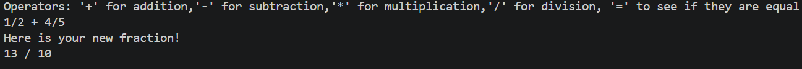
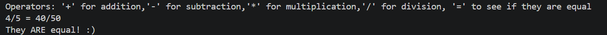
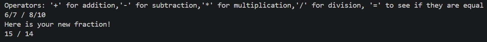

# Fractions Calculator
Personal project  
2022-2022   

A terminal-based fraction calculator app written in C++ that can add, subtract, multiply, divide, reduce, and verify equality. 

Uses OOP with the `fractions` class.

## Sample Operations
Sample addition:

  
Sample equality:

  
Sample Division:

